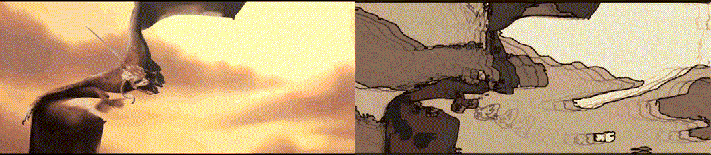
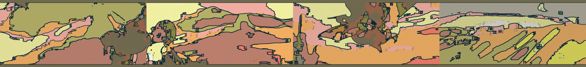

# rigpop-ink



<sub>The demo clip is rendered with `--preset manga-noir --seed 7`. Left: the original plate. Right: what rigpop-ink returns, with the source's audio intact.</sub>

**Footage that redraws itself.** Point it at a clip and every frame is re-painted as
ink-on-paper — flat paint bands, contour lines that *tremble*, a print-shop dot screen —
except the parts that usually make a video filter feel dead are directed by the film
itself:

| the clip says | the renderer does |
|---|---|
| an audio onset lands | the line **punches** thicker for 160 ms and the boil re-rolls, so the drawing trembles *on the hit* |
| the picture cuts | the whole frame changes **ink key** — new ink colour, new paper tone |
| the frame is busy | contour gets **heavy**, dot screen tightens; still frames get hairlines |
| the frame is underexposed | **auto-levels + shadow lift** open it up before the paint bands are cut |
| the clip has letterbox bars | **autocropped** away before a single pixel is inked |

No ML, no GPU, no `-vf edgedetect`. Every stage below is a hand-written pixel pass in
plain JavaScript. Output keeps the original audio.

---

## Quickstart

```bash
npm run fetch:demo                      # pulls the demo clip (CC-BY, see credits)
node bin/rigpop-ink.js probe  demo/source-sintel.mp4
node bin/rigpop-ink.js still  demo/source-sintel.mp4 -o out/f.png --at 26 --preset pulp-horror
node bin/rigpop-ink.js restyle demo/source-sintel.mp4 -o out/ink.mp4 --preset manga-noir --seed 7
npm run serve                           # the darkroom, in a browser
```

Requires Node ≥ 20 and an `ffmpeg` binary (`ffmpeg-static` is picked up automatically,
or set `FFMPEG_PATH`). Canvas comes from the same toolchain the rest of the rig uses
(`@napi-rs/canvas`).

## What you get

```
rigpop-ink probe demo/source-sintel.mp4
  video     854x480 @ 24 fps  52.21s  h264
  cuts      10  at 16.50, 17.50, 23.79, 25.88, 26.58 …
  onsets    157  first 3.04, 5.09, 5.22, 5.34 …
  tempo     ~312.5 bpm (median gap 0.19s)
  drama     mean 0.19 peak 1.00
```

Those four numbers are the entire directing brief. `probe` is what I use to decide
whether a clip is going to ink well before spending render time on it.

Four consecutive shots, `--preset riso`, one render — the ink key changes on every cut:



## The six stages, per frame

```
rgba  →  integrate  →  kuwahara  →  cel  →  contour  →  ink boil  →  dot screen  →  rgba
         (5 summed-      (paint       (bands +   (Sobel on    (coverage      (45° screen,
          area tables)    regions)     auto     the flat     field, sub-     scaled to the
                                       levels)   image)       pixel wobble)   frame)
```

1. **integrate** — five summed-area tables over the frame (luma, luma², R, G, B), so any
   window's mean and variance is four array reads. This is why brush size is free.
2. **kuwahara** — classic four-quadrant selective flatten: pick the *lowest-variance*
   quadrant and take its mean. Regions go flat, edges stay put. Integral images make the
   window size cost nothing, so radius is measured in "480-line units" and scales with the
   frame (a 720p render gets a bigger brush than a 480p one, automatically).
3. **shadow lift + auto levels** — per frame: median luminance sets a gamma, then the
   2nd/98.5th luminance percentiles set the black and white points. Same preset, day
   exterior or night interior, no dial-twiddling.
4. **cel** — quantise into N paint bands with a saturation pull toward luma. This is the
   "printed" part.
5. **contour** — Sobel on the *flattened* luma (never the raw frame — raw grain turns into
   confetti), gated out of deep shadow so black areas stay solid ink, despeckled (a line is
   a run, not a speck), then split into detail lines and **strong contours**. The mask is
   blurred into a coverage field and sampled **bilinearly** with a sub-pixel offset, so
   lines are antialiased and the boil wobbles them instead of jittering them.
6. **dot screen** — an 8×8 round-dot screen at 45°, scaled to the frame, applied only in
   the mid-shadow band: solid blacks stay solid, and it reads as print rather than dither.

Then a 1-pixel clamp-shift "hand-held" wobble, and the frame is piped as raw RGBA straight
into x264 with the source's own audio muxed back in.

## Presets

| preset | what it is |
|---|---|
| `manga-noir` | bilevel shadows, thick contour, hard dot screen |
| `ghazal` | warm sepia wash, hairline contour, soft grain — slow songs |
| `pulp-horror` | acid spot inks, crushed contrast, screen-print dots |
| `riso` | four plates apart, two-spot risograph |
| `blueprint` | ink lines only, no fill, no dots — blocking shots |

Each preset carries a **key family**: two to four (ink, paper) pairs. A cut advances the
key, so one render can change colour per shot.

## The darkroom

`npm run serve` gives a local page with the frame up top, the drama curve and the cut/onset
ticks on the timeline underneath, and the press on the right: line weight, dot screen,
paper grain, paint bands, pigment, contour detail, paper tint, seed. Slide, scrub, watch
the ink respond — the preview is the same code path as the film, at 0.55 scale. *Ink the
whole clip* runs the render as a job and plays the result inline.

```
GET  /api/library            clips the server will ink
GET  /api/analyze?file=      cuts, onsets, tempo, letterbox, drama
GET  /api/preview?…          one stilled frame, PNG
POST /api/render             start a job  → { id }
GET  /api/job/:id            progress
GET  /api/out/:id            finished mp4 (range-capable)
```

## CLI

```
restyle  <in> -o <out.mp4>   --preset --start --dur --scale --seed --crf --fps
                             --no-beat --no-cuts --no-drama --no-shake
still    <in> -o <out.png>   --at <s>  (same flags)
probe    <in>                the director's read on a clip
presets
serve                        --port 8137 --file a.mp4,b.mp4
```

`--no-beat`, `--no-cuts`, `--no-drama`, `--no-shake` switch each directing rule off, which
is also the fastest way to see what the rules are actually doing: render the same window
twice, once with `--no-cuts` and once without, and flip between them.

## Determinism

Same file + same preset + same seed + same flags = byte-identical output. Every random
thing (paper grain, boil offsets, key rotation) is seeded from `(seed, shot, onset count)`,
never from time. That means a render can be diffed, cached and re-made.

## Speed

One core, no GPU: roughly **4–6 frames/s at 852×372** and **2 f/s at 720p**, i.e. a 52-second
24 fps clip lands in about five minutes. Stages are all O(pixels) with no per-pixel
allocation; the only per-frame temporaries are reused buffers.

## Not in scope

Not a style-transfer model, not temporally consistent in the ML sense — it's a *renderer*.
It has no idea a person is a person; it flattens what it is given. Busy, low-contrast
footage (shaky handheld in a dark interior) inks muddier than clean, high-contrast,
strongly-blocked footage. That is what `probe` is for.

## Making the demo yourself

```bash
npm run fetch:demo                                   # 4 MB, CC-BY trailer
node bin/rigpop-ink.js restyle demo/source-sintel.mp4 -o out/ink-sintel.mp4 --preset manga-noir --seed 7
node scripts/make-demo.mjs out/ink-sintel.mp4        # rebuilds docs/demo.gif + docs/poster.jpg
```

The rendered mp4 is not committed (25 MB, and it is one command away). The GIF and the
poster are, because a look-dev repo should show the look on the front page.

## Credits

Demo clip: **Sintel** trailer — © Blender Foundation | durian.blender.org — CC-BY 3.0.
Fetched by `scripts/fetch-demo.mjs`, not committed.

Code: MIT.
